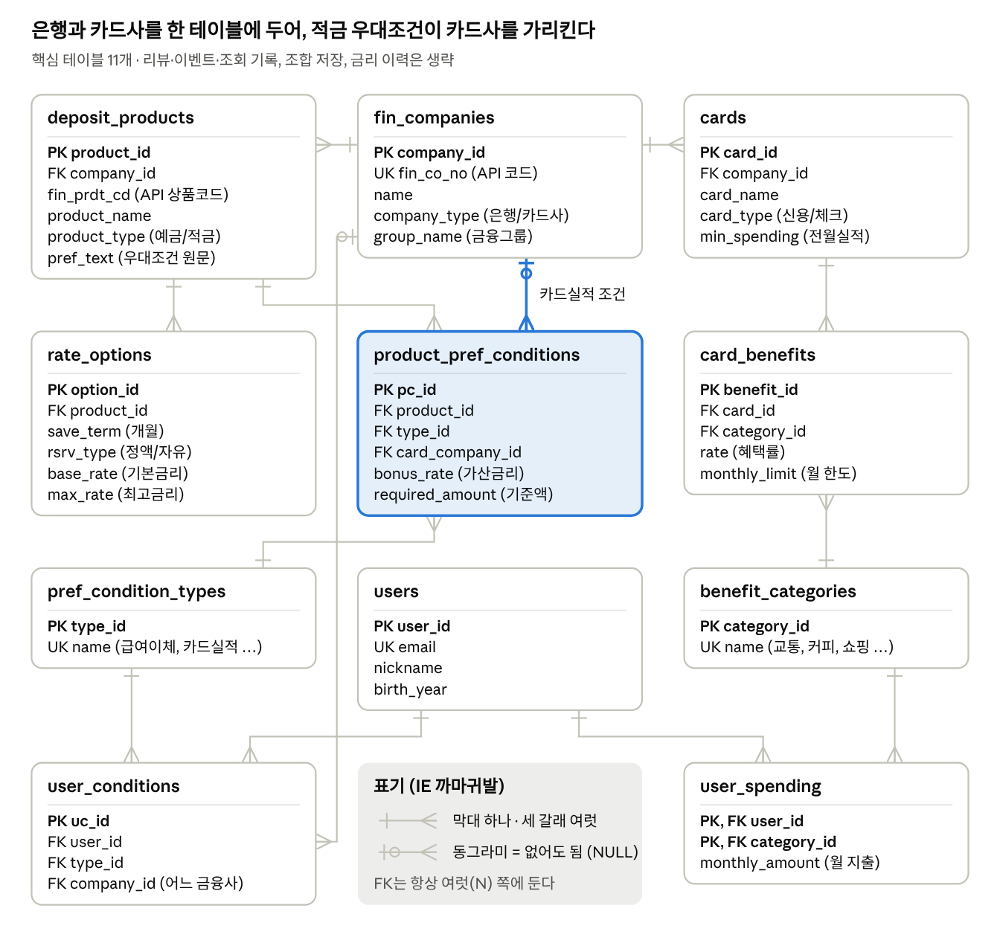

# 카드 + 적금 묶음 비교

내 소비 패턴과 금융 상황을 넣으면, 카드 혜택과 적금 세후 이자를 합친 **실제로 받을 돈** 순으로 카드 + 적금 조합을 보여주는 서비스.

중앙대 데이터베이스 설계_기초(2026-2) 프로젝트로 시작했고, 실제 사용자가 쓰는 계산기로 키우는 중.

## 왜 만드나

비교 사이트는 최고금리와 할인율을 보여준다. 그런데 실제로 받는 돈은 조건에 따라 갈린다.

- 카드는 전월실적을 못 채우면 혜택이 0원이고, 혜택률이 높아도 월 한도에서 잘린다.
- 적금 최고금리는 급여이체, 카드 실적 같은 우대조건을 다 채웠을 때의 숫자다.
- 적금 우대조건에 "○○카드 월 30만 원 이상 사용"이 자주 붙는데, 카드 비교와 적금 비교는 서로 다른 사이트에 있다.

이 서비스는 우대조건을 문장이 아니라 데이터로 쪼개 저장하고, 적금 우대조건이 카드사를 가리키게 설계했다. 그래서 **고른 카드에 따라 적금 금리가 바뀌는 계산**을 SQL 한 번으로 한다.

예) 신한은행으로 월급을 받는 직장인이 신한카드를 고르면 신한 알.쏠 적금 금리가 4.25%까지 올라간다(소득이체 +0.6%p, 청약 +0.3%p, 신한카드 이용 +0.3%p).

## DB 구조



테이블 13개, 계산 VIEW 4개 (MySQL 8).

| VIEW | 계산 |
| --- | --- |
| `v_user_total` | 회원별 월 총지출 |
| `v_card_benefit` | 회원 × 카드 월 혜택액. 실적 미달이면 0원, 카테고리별 월 한도 적용, '국내전체' 혜택은 총지출 기준 |
| `v_my_rate` | 회원 × 카드 × 적금옵션. 기본금리 + 충족한 우대조건, 최고금리 상한 |
| `v_combo_ranking` | 카드 혜택 + 적금 세후이자(정액적립 단리, 이자소득세 15.4%) ÷ 기간 |

## 데이터 출처

| 데이터 | 출처 | 저장소 포함 |
| --- | --- | --- |
| 은행 적금 상품, 기간별 금리 | [금융감독원 금융상품한눈에 Open API](https://finlife.fss.or.kr) | 스크립트로 받음 |
| 적금 우대조건 (항목별로 쪼갠 것) | 위 API의 우대조건 원문을 직접 분해 | `sql/03_pref_conditions.sql` |
| 카드 상품, 혜택 | 수업용으로 카드고릴라 화면을 옮겨 적음 | **포함 안 함** |

카드 데이터는 공개 서비스에 쓰지 않는다. 카드사 공식 상품설명서 기준으로 다시 정리한 뒤 출처 URL과 기준일을 함께 넣을 예정이다. 카드 상품 정보를 통합 제공하는 공개 API는 없다(2026-10 기준).

## 실행 순서

MySQL Workbench에서 SQL 파일은 File → Open SQL Script로 열고 번개 아이콘으로 실행한다.

1. `sql/01_schema.sql` — 테이블 13개 (기존 finance_db는 지워짐)
2. `sql/02_views.sql` — 계산 VIEW 4개
3. `.env.example`을 복사해 `.env`를 만들고 인증키, MySQL 비밀번호 입력
4. `pip install requests pymysql` 후 `python scripts/load_finlife.py` — 은행 적금 데이터 입력
5. `sql/03_pref_conditions.sql` — 우대조건 (상품 번호가 4번 실행 결과와 같아야 함)
6. `sql/04_categories.sql` — 카드사, 혜택 카테고리
7. 카드 데이터 입력 (저장소 밖)
8. `sql/05_test_users.sql` — 테스트 회원 3명과 결과 확인 쿼리

진행 상황은 `sql/status_check.sql` 하나로 확인한다.

## 앱 실행 (1차 초안)

DB를 만든 뒤 터미널에서:

```bash
pip install -r requirements.txt
python app/server.py
```

브라우저에서 http://localhost:5000 (맥에서 5000번이 막혀 있으면 `PORT=5050 python app/server.py`).
API와 구조는 `app/README.md`.

## 폴더

```
sql/                 스키마, VIEW, 데이터 입력, 점검 쿼리
sql/practice/        수업 주차별 실습을 이 DB에 적용한 것
scripts/             API 수집 스크립트
app/                 Flask API(server.py)와 모바일 웹 화면(static/)
docs/progress.md     날짜별 진행 기록과 결정 사항
```

## 다음 작업

- 고율 카드 혜택 월 한도 채우기 (지금은 비어 있어 혜택이 과대 계산됨)
- 연회비 ÷ 12 차감을 VIEW에도 반영 (지금은 API에서만 차감)
- 나머지 적금 47개 우대조건 분해
- Flask 계산기 화면 (로그인 없이 입력 → 결과)
